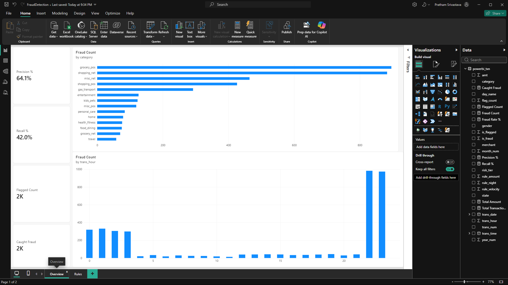
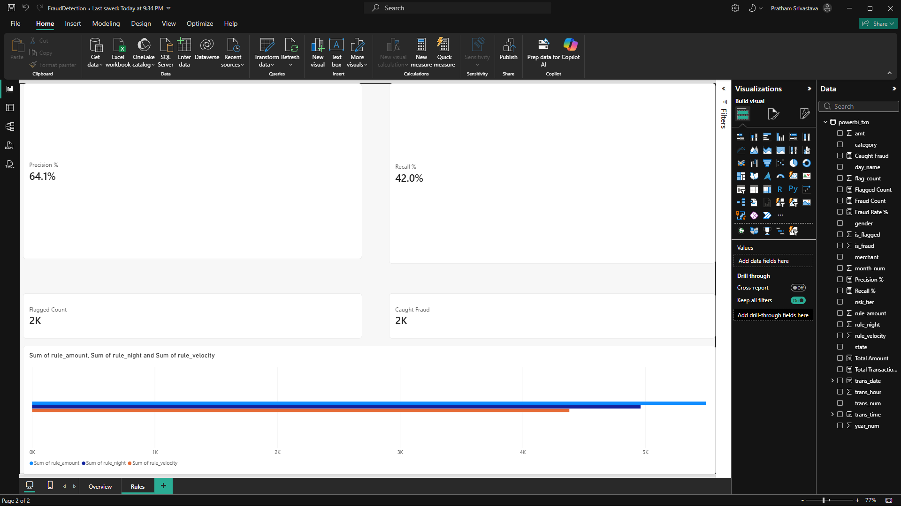
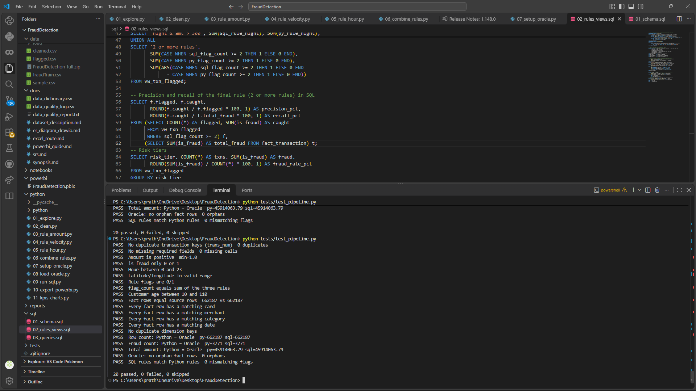
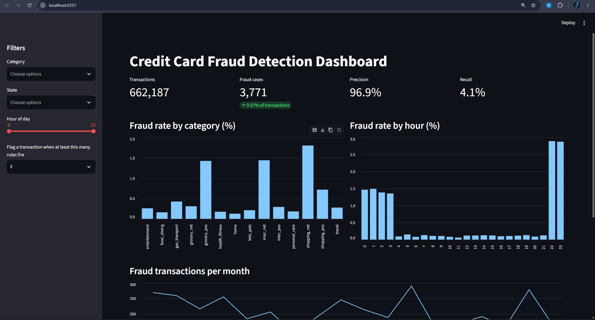
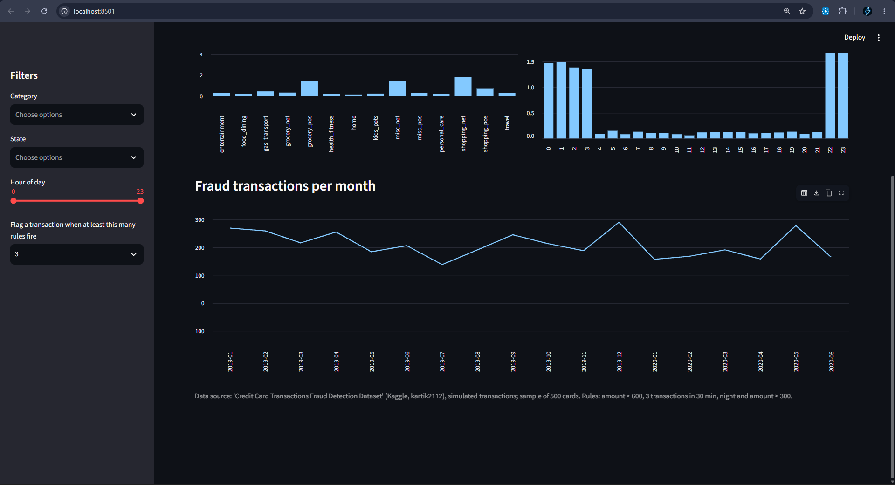

# Fraud Detection: Rule-based Analysis (Python + Oracle SQL + Power BI)

## Overview
Credit card transactions par rule-based fraud detection. Rules Python mein banaye aur Oracle SQL mein dobara chalake verify kiye. Results Power BI dashboard mein dikhaye hain.

## Key Results
| Metric | Value |
|---|---|
| Total transactions | 662,187 |
| Fraud transactions | 3,771 |
| Flagged by final rule (2 or more rules) | 2,468 |
| Caught fraud | 1,582 |
| Precision | 64.1% |
| Recall | 42.0% |
| Night-time share of fraud | 85.1% |

## Rules
1. **Amount rule:** amount > 600
2. **Velocity rule:** <ek line mein likho kaise define kiya>
3. **Night rule:** night hours (22 se 3) aur amount > 300
4. **Final rule:** transaction flag hota hai agar 2 ya zyada rules lage

## Tech Stack
Python (pandas), Oracle XE 21c, SQL, Power BI

## Project Structure
```
python/    data cleaning, rules, Oracle load, export scripts (01 se 11)
sql/       schema, rule views, queries
powerbi/   FraudDetection.pbix
tests/     test_pipeline.py
docs/      data dictionary, quality report, ER diagram
reports/   charts aur outputs
app/       Streamlit dashboard (streamlit_app.py)
```

## How to Run
```
pip install -r requirements.txt
python python/01_explore.py
python python/02_clean.py
python python/03_rule_amount.py
python python/04_rule_velocity.py
python python/05_rule_hour.py
python python/06_combine_rules.py
python python/07_setup_oracle.py      # Oracle SYSTEM password maangega
python python/08_load_oracle.py
python python/09_run_sql.py sql/02_rules_views.sql
python tests/test_pipeline.py
python -m streamlit run app/streamlit_app.py
```
Oracle step ke liye Oracle XE chalu hona chahiye (`localhost:1521/XEPDB1`).
Dashboard chalane se pehle pipeline scripts (01 se 06) chalao, kyunki `data/` GitHub par nahi hai aur `data/flagged.csv` unhi se banti hai.
## Verification
Oracle SQL results Python se verified hain (0 mismatches). 20 tests passed.

| Rule | SQL count | Python count | Mismatches |
|---|---|---|---|
| amount > 600 | 5494 | 5494 | 0 |
| velocity | 4381 | 4381 | 0 |
| night and amt > 300 | 4962 | 4962 | 0 |
| 2 or more rules | 2468 | 2468 | 0 |

## Dashboard






## Dataset

## Author
PrathamSrivastava 